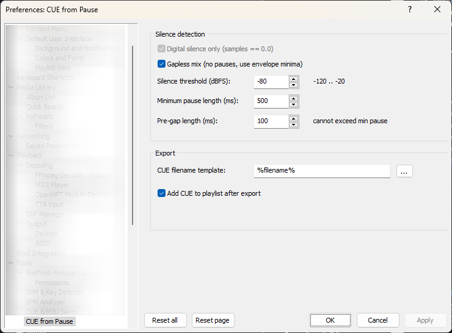
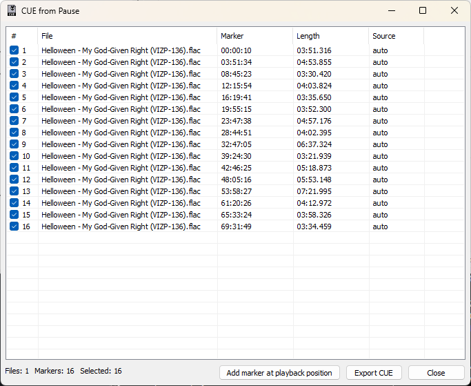

# CUE from Pause (foo_cuepause)

A foobar2000 component that scans audio files for silent pauses and exports a CUE sheet with track markers.





[English](#english) · [Русский](#russian)

---

<a name="english"></a>
## English

### What it does

**CUE from Pause** analyses selected audio tracks, detects silent pauses and gapless transitions between tracks, and generates a CUE sheet with markers placed just before each track starts. The result can be exported as a `.cue` file next to the source audio and (optionally) added to the current foobar2000 playlist, where you can then fill in track titles and other metadata for the generated file.

Typical use cases:

- **CD rips saved as one long file.** The component finds the pauses between tracks and produces a proper CUE.
- **Vinyl rips** where each side is a single file. Select all sides at once — they will be written into a single CUE in playlist order.
- **Albums without pauses** (gapless, cross-faded). Enable **Gapless mix** — markers will be placed at the quietest point between tracks.
- **Mixed albums** where some tracks have pauses and some flow into each other. Gapless mix handles both cases in a single pass.

### Features

- Scans one or multiple selected tracks in the background — the player stays responsive.
- Three detection modes:
  - **Digital silence only** — samples strictly equal to `0.0` (perfect for CD rips).
  - **Threshold mode** — samples below a configurable dBFS level (recommended for vinyl rips; try `-50` … `-60` dBFS).
  - **Gapless mix** — combined analysis: real silence pauses + local minima of the RMS envelope, so gapless and mixed albums are handled without manual tuning. Digital silence mode is disabled while Gapless mix is on.
- Configurable **minimum pause length** and **pre-gap length**. The pre-gap is automatically limited to the pause length — a marker never lands inside the previous track.
- The first marker of each file always leaves at least `0.2 s` (or the configured pre-gap, whichever is larger) before the first non-silent sample. If there is not enough silence at the start of the file, the marker is placed at `0`.
- **Manual markers** — press *Add marker at playback position* during playback or while paused to insert an extra boundary at the current playback time.
- Results dialog with per-marker checkboxes. Only the checked markers are written to the CUE.
- **Track lengths are recalculated live** when you uncheck a marker — its duration is merged into the previous checked marker, and restored when you re-check it.
- CUE header (`PERFORMER`, `TITLE`, `REM DATE`, `REM GENRE`) is filled from the tags of the first selected file.
- `INDEX 00` is written for the first track of each file when the leading pause does not start at sample 0.
- If a CUE file with the same name already exists, the new one gets a ` (01)`, ` (02)`, … suffix — nothing is overwritten.
- Optionally adds the exported CUE to the **current active playlist**. The CUE is expanded into individual tracks by foobar2000's built-in CUE reader.
- Full **dark mode** support for both the settings page and the results dialog.
- Column widths and window position are remembered between sessions.

### Settings

All settings live under **Preferences → Tools → CUE from Pause**.

| Setting | Default | Description |
|---|---|---|
| Digital silence only | on | Detect silence as samples exactly equal to `0.0`. Disabled while *Gapless mix* is on (the checkbox state is preserved). |
| Gapless mix | off | Combined analysis: pauses + local minima of the RMS envelope. Recommended for gapless and mixed albums. |
| Silence threshold (dBFS) | `-60` | Used only when *Digital silence only* is off. In gapless mode this threshold is applied to the RMS envelope. Range: `-120` … `-20`. |
| Minimum pause length (ms) | `500` | Pauses shorter than this are ignored. In gapless mode this also defines the minimum length of a "real" pause: silence shorter than this is treated as a transition, not a pause. Minimum value: `1`. |
| Pre-gap length (ms) | `200` | Offset of the marker before the end of the pause. Automatically capped by the minimum pause length. Not changed automatically when switching modes — the user decides. |
| CUE filename template | `%filename%` | Supports `%filename%`, `%album%`, `%artist%`. Free text is allowed — e.g. `MyAlbum` produces `MyAlbum.cue`. |
| Add CUE to playlist after export | on | Appends the exported CUE to the current active playlist. |

### How to use

1. Select one or more tracks in a foobar2000 playlist.
2. Right-click → **Utilities → Create CUE from pauses**.
3. The scan runs in the background. When it finishes, the results dialog appears.
4. Review the markers. Uncheck the ones you do not want in the CUE.
5. (Optional) Start playback and press **Add marker at playback position** to insert extra markers.
6. Press **Export CUE**. The CUE is written next to the first selected audio file. If *Add CUE to playlist after export* is enabled, it is also inserted into the current playlist — open it there to add track titles and other metadata to the generated file.

### Building

Requirements:

- Visual Studio 2019 or later (x86 / x64).
- [foobar2000 SDK](https://www.foobar2000.org/SDK) (2022 or newer).
- [pfc](https://www.foobar2000.org/SDK) (ships with the SDK).
- [libPPUI](https://www.foobar2000.org/SDK) (ships with the SDK).
- [WTL](https://sourceforge.net/projects/wtl/) (any recent version).

The project is expected to be laid out like this:

```
source/repos/
├── foobar2000/
│   ├── SDK/
│   ├── helpers/
│   ├── foobar2000_component_client/
│   └── shared/
├── pfc/
├── libPPUI/
├── WTL/
│   └── Include/
└── foo_cuepause/
```


Add `SDK`, `helpers`, `pfc`, `libPPUI` and `WTL\Include` to **C/C++ → General → Additional Include Directories**. Add `foobar2000_component_client`, `foobar2000_SDK`, `pfc`, `shared`, `foobar2000_SDK_helpers` and `libPPUI` as **Project References**.

The build produces `foo_cuepause.dll`. Place it into `foobar2000\user-components\foo_cuepause\` (or install the resulting `.fb2k-component` archive).

### License

MIT — see [LICENSE](LICENSE).

---

<a name="russian"></a>
## Русский

### Что делает

**CUE from Pause** анализирует выбранные аудиофайлы, находит паузы тишины и бесшовные переходы между треками, формирует CUE-файл с метками, поставленными незадолго до начала каждого трека. Результат можно сохранить как `.cue` рядом с исходным аудио и (по желанию) добавить в текущий плейлист foobar2000, где можно добавить названия треков и другую информацию в созданный файл.

Типичные сценарии использования:

- **Рипы CD, сохранённые одним длинным файлом.** Компонент находит паузы между треками и строит корректный CUE.
- **Рипы с винила**, где каждая сторона — отдельный файл. Выделите все стороны сразу — они попадут в один CUE в порядке плейлиста.
- **Альбомы без пауз** (gapless, с перекрёстным затуханием). Включите **Gapless mix** — метки встанут в самом тихом месте на стыке треков.
- **Смешанные альбомы**, где часть треков идёт через паузу, а часть — бесшовно. Gapless mix разбирает оба случая за один проход.

### Возможности

- Сканирование одного или нескольких выделенных треков в фоне — плеер не блокируется.
- Три режима определения тишины:
  - **Digital silence only** — сэмплы строго равны `0.0` (идеально для CD-рипов).
  - **Режим порога** — сэмплы ниже заданного уровня в dBFS (рекомендуется для винила; попробуйте `-50` … `-60` dBFS).
  - **Gapless mix** — комбинированный анализ: настоящие паузы + локальные минимумы огибающей RMS, поэтому gapless- и смешанные альбомы разбираются без ручной подстройки. Режим Digital silence при этом отключается.
- Настраиваемые **минимальная длина паузы** и **длина прегапа**. Прегап автоматически ограничивается длиной паузы — метка никогда не залезает в предыдущий трек.
- Первая метка каждого файла всегда оставляет не менее `0.2 с` (или настроенный прегап, если он больше) до первого непустого сэмпла. Если тишины в начале файла недостаточно, метка ставится в `0`.
- **Ручные метки** — кнопка *Add marker at playback position* во время воспроизведения или паузы добавляет дополнительную границу в текущей позиции плеера.
- Диалог результатов с чекбоксами напротив каждой метки. В CUE попадают только отмеченные.
- **Длительность треков пересчитывается на лету** при снятии галочки — её отрезок «прилипает» к предыдущей отмеченной метке; при возврате галочки — восстанавливается.
- Шапка CUE (`PERFORMER`, `TITLE`, `REM DATE`, `REM GENRE`) заполняется из тегов первого выбранного файла.
- INDEX 00 пишется для первого трека каждого файла, если вступительная пауза начинается не с нулевого сэмпла.
- Если CUE с таким именем уже существует, новый получит суффикс ` (01)`, ` (02)`, … — ничего не перезаписывается.
- Экспортированный CUE при желании добавляется в **текущий активный плейлист**. CUE разворачивается в отдельные треки встроенным CUE-ридером foobar2000.
- Полная поддержка **тёмной темы** — и в настройках, и в диалоге результатов.
- Ширины колонок и положение окна запоминаются между сессиями.

### Настройки

Все настройки находятся в **Preferences → Tools → CUE from Pause**.

| Настройка | По умолчанию | Описание |
|---|---|---|
| Digital silence only | вкл. | Определять тишину как сэмплы, строго равные `0.0`. Отключается при включении *Gapless mix* (галочка внутри сохраняется). |
| Gapless mix | выкл. | Комбинированный анализ: паузы + локальные минимумы огибающей RMS. Рекомендуется для gapless- и смешанных альбомов. |
| Silence threshold (dBFS) | `-60` | Используется только когда *Digital silence only* выключен. В gapless-режиме этот порог применяется к огибающей RMS. Диапазон: `-120` … `-20`. |
| Minimum pause length (ms) | `500` | Паузы короче игнорируются. В gapless-режиме это же значение задаёт минимальную длину «настоящей» паузы: тишина короче считается переходом, а не паузой. Минимум: `1`. |
| Pre-gap length (ms) | `200` | Смещение метки от конца паузы. Автоматически ограничивается минимальной длиной паузы. При переключении режимов **не меняется автоматически** — решает пользователь. |
| CUE filename template | `%filename%` | Поддерживаются `%filename%`, `%album%`, `%artist%`. Можно писать произвольный текст — например, `MyAlbum` даст `MyAlbum.cue`. |
| Add CUE to playlist after export | вкл. | Добавлять экспортированный CUE в текущий активный плейлист. |

### Как пользоваться

1. Выделите один или несколько треков в плейлисте foobar2000.
2. Правый клик → **Utilities → Create CUE from pauses**.
3. Сканирование идёт в фоне. По завершении открывается диалог с результатами.
4. Просмотрите метки. Снимите галочки с тех, которые не должны попасть в CUE.
5. (Необязательно) Запустите воспроизведение и нажмите **Add marker at playback position**, чтобы добавить дополнительные метки.
6. Нажмите **Export CUE**. Файл запишется рядом с первым из выделенных аудиофайлов. Если включена опция *Add CUE to playlist after export*, он также появится в текущем плейлисте — откройте его там, чтобы добавить названия треков и другую информацию в созданный файл.

### Сборка

Требования:

- Visual Studio 2019 или новее (x86 / x64).
- [foobar2000 SDK](https://www.foobar2000.org/SDK) (2022 или новее).
- [pfc](https://www.foobar2000.org/SDK) (идёт в составе SDK).
- [libPPUI](https://www.foobar2000.org/SDK) (идёт в составе SDK).
- [WTL](https://sourceforge.net/projects/wtl/) (любая свежая версия).

Ожидаемая раскладка репозиториев:

```
source/repos/
├── foobar2000/
│   ├── SDK/
│   ├── helpers/
│   ├── foobar2000_component_client/
│   └── shared/
├── pfc/
├── libPPUI/
├── WTL/
│   └── Include/
└── foo_cuepause/
```

Добавьте `SDK`, `helpers`, `pfc`, `libPPUI` и `WTL\Include` в **C/C++ → General → Additional Include Directories**. Подключите как **Project References** проекты `foobar2000_component_client`, `foobar2000_SDK`, `pfc`, `shared`, `foobar2000_SDK_helpers` и `libPPUI`.

В результате сборки получится `foo_cuepause.dll`. Положите его в `foobar2000\user-components\foo_cuepause\` (или соберите `.fb2k-component` архив).

### Лицензия

MIT — см. [LICENSE](LICENSE).